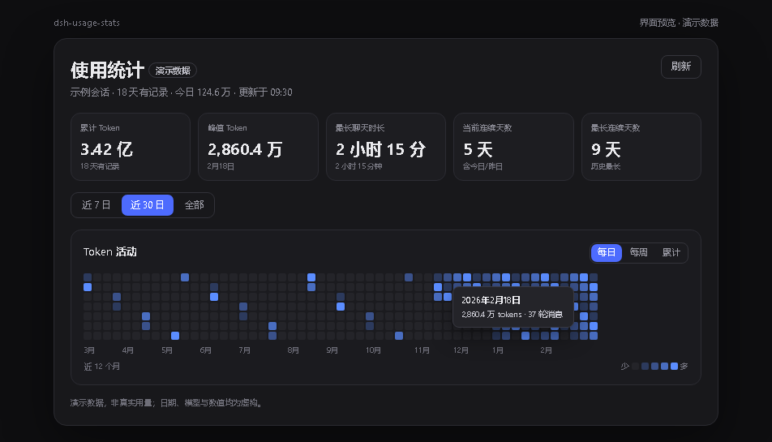
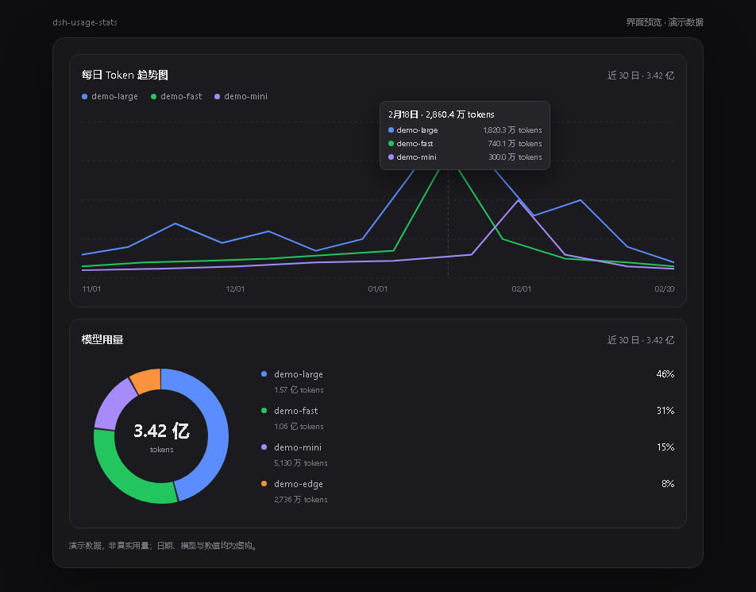

# dsh-usage-stats

在 DSH 设置里增加一个 **使用统计** 页面：扫描本机全部会话日志，汇总累计、峰值、连续天数、聊天时长、每日趋势和模型用量。





> 预览图使用虚构的演示数据，不含真实会话、账号或用量。

## 统计口径

- Token：`输入 + 缓存读取 + 缓存写入 + 输出`，与 DSH 自己的 `tokenUsage` 投影一致。
- 会话：包含子会话，跨工作区汇总；被 fork 的子会话会物理复制父会话日志，统计时用 `inheritedEventCount` 去掉父会话前缀，避免重复计费。
- 模型：取自每条 `assistant/message` 的 `message.source.model`；没有该字段的旧日志回退到最近的 `request/header.config.model`。
- 聊天时长：同一会话内相邻事件间隔不超过 1 小时才累计；长时间挂起不会把“聊了几天”算成一次聊天。
- 连续天数：按本地日期统计有 Token 用量的连续天数。

数据来自 `sessionQuery` 对持久化日志的重放；不会改写日志。首次打开会在后台扫描全部会话（几百个会话通常十几秒到半分钟，视日志量而定），随后缓存 5 分钟，页面上的“刷新”会强制重算。

## 页面内容

- 五张卡片：累计 Token、峰值 Token、最长聊天时长、当前连续天数、最长连续天数。
- Token 活动热力图：近 12 个月，支持每日 / 每周 / 累计三种聚合；悬停格子显示日期、Token 数和轮消息数。
- 每日 Token 趋势图：按模型分线（前 5 个模型 + 其他），可切换近 7 日 / 近 30 日 / 全部；悬停显示当天总量、各模型明细和十字线。
- 模型用量环图：当前时间范围内的模型占比与 Token 数。

## 安装

从 GitHub 安装：

```bash
dsh plugin --profile desktop add github:XEsx630/dsh-usage-stats
```

本地开发时，也可以在 **插件 / Plugins** 页面选择 **Add plugin**，填入本目录的绝对路径并启用 `dsh-usage-stats`。两种方式都依赖 profile 里声明的 bundle；HMR 会热加载，如果设置侧栏没有出现 **使用统计**，刷新页面（`Ctrl+R`）或重启 DSH。

## 卸载

在插件页面卸载，或从 profile 的 `package.json` 中删除 `dsh-usage-stats` 依赖与 bundle 条目，再删掉 `node_modules/dsh-usage-stats`。

## 结构

| 文件 | 作用 |
|---|---|
| `index.js` | Host 半：重放会话、按日期/模型折叠、`/dsh-usage/api/stats` |
| `client.js` | 浏览器半：注册 `settings.section`，绘制卡片、热力图、趋势图和环图 |
| `cordis.patch.yml` | 把 Host 插件插入 profile |
| `test/fold.test.js` | 折叠、模型归属、fork 前缀的自检（`node --test`） |

## API

`GET /dsh-usage/api/stats`（同源、仅本机 Host）返回：

```json
{
  "generatedAt": 1792416000000,
  "sessions": 76,
  "failed": 0,
  "longestChatMs": 63000000,
  "totals": { "input": 0, "output": 0, "cacheRead": 0, "cacheWrite": 0, "total": 0 },
  "days": [{ "date": "2026-10-19", "input": 0, "output": 0, "cacheRead": 0, "cacheWrite": 0, "turns": 0, "total": 0 }],
  "models": [{ "model": "deepseek-v4.1-flash", "input": 0, "output": 0, "cacheRead": 0, "cacheWrite": 0, "total": 0 }],
  "modelDays": [{ "date": "2026-10-19", "models": [{ "model": "deepseek-v4.1-flash", "total": 0 }] }]
}
```

`?refresh=1` 跳过 5 分钟缓存。
